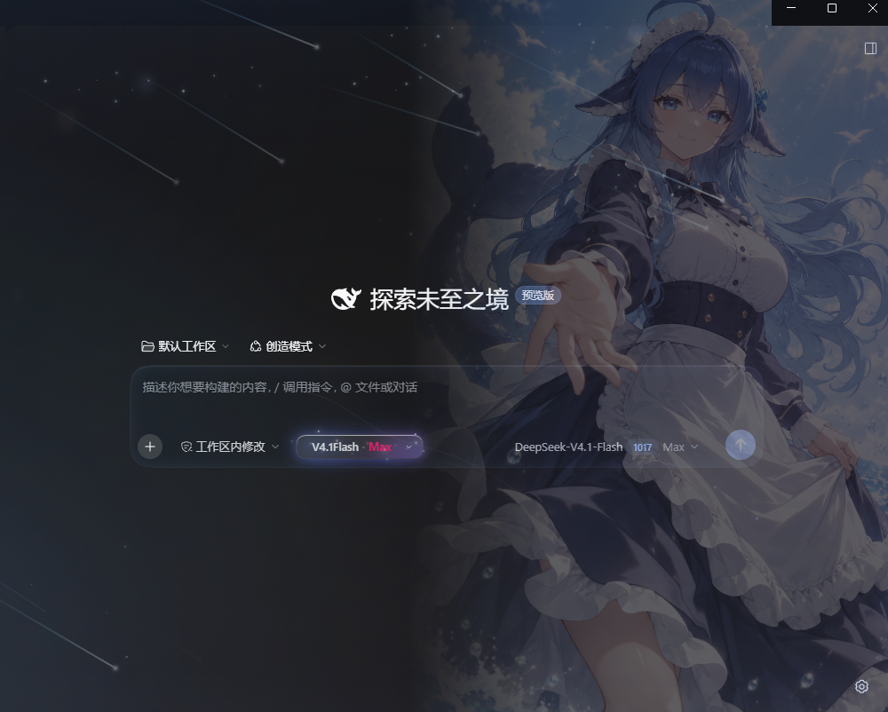
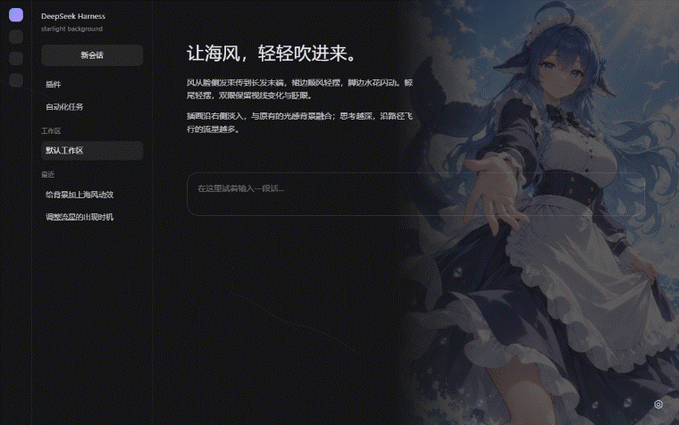
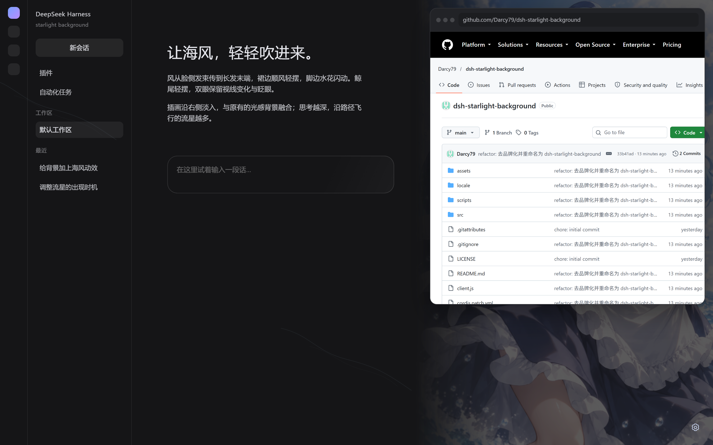
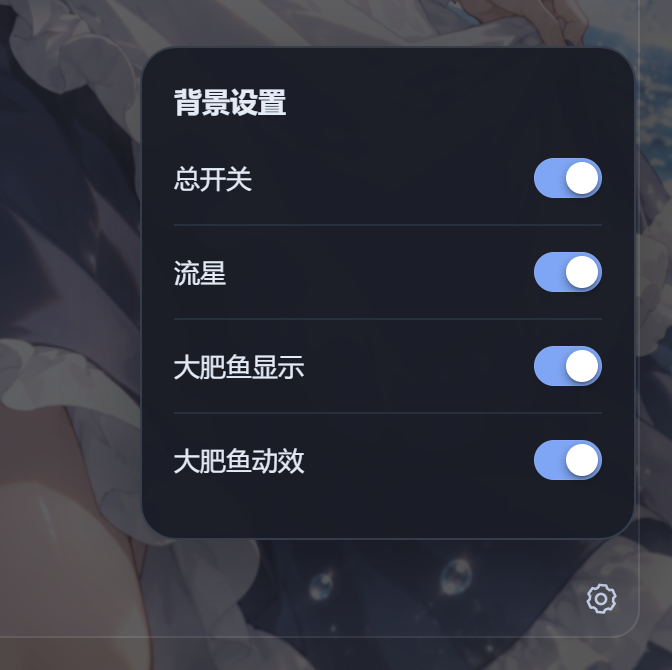

# dsh-starlight-background · 星轨光感

> 海风插画、轻摆的长发与裙边、轻晃的鲸尾，以及会跟着思考沿路径飞行的流星。

## 样图

Harness 深色主题下的实际效果：插画铺满右侧，输入栏与强度胶囊浮在光场之上。



背景动效：插画随呼吸缓慢摆动，流星按推理等级沿路径飞入飞出。



在 Harness 里打开网页时，浮层只作用于背景，面板内容保持清晰可读。



右下角齿轮打开背景设置：总开关、流星、插画显示与其动效各自独立控制。



## 精简设置外观（0.4.1）

- 右下角只显示齿轮图标，去掉底色和边框，保留悬停旋转及键盘聚焦提示。
- 设置弹窗四行只保留控制名称和开关，移除说明文字并收窄弹窗。

## 齿轮设置与独立控制（0.4.0）

右下角改为齿轮入口，悬停时轻转约 65°。点击打开设置小弹窗，点击外部或按 Escape 关闭；
Escape 会把焦点还给齿轮。所有开关沿用原来的 胶囊样式。

| 开关 | 行为 |
| --- | --- |
| 总开关 | 一键开关全部背景效果和玻璃样式；Alt+L 仍然可用；关闭时保留子项选择 |
| 流星 | 独立控制固定、周期性与新想法流星；开启后继续按当前思考深度联动 |
| 大肥鱼显示 | 显示或隐藏背景人物；关闭时同时关闭大肥鱼动效 |
| 大肥鱼动效 | 控制人物、双手、鲸尾、水花、眼神、眨眼及海风；关闭后显示静态原图 |

- 大肥鱼隐藏时动效开关禁用；重新显示时先保持静态，需要手动开启动效。
- 总开关关闭时子项禁用，齿轮始终可打开；重新开启后恢复子项选择。
- 设置保存在本机，刷新后保留。沿用原总开关的存储键，旧版状态继续生效。
- 流星关闭时停止周期生成、清除待消失的周期流星，并阻止新增想法流星；改变思考深度
  不会重新打开流星。再开启时读取当前档位，以 2 / 4 / 7 / 10 颗恢复固定流星。
- 大肥鱼隐藏或动效关闭时停止其 GPU 绘制；静态模式使用原图，所有人物动效和海风均停止。
- 回归覆盖设置依赖、刷新记忆、深浅色、窄屏、键盘关闭与数量联动。刷新 Harness（Ctrl+R）
  加载新版；深浅色设置截图位于 `artifacts/settings-dark.png`、`artifacts/settings-light.png`。

## 传递风向、脸侧发束、双手和水花（0.3.4）

- 再次加大长发与裙边摆幅。风压波沿左上→右下传播，不同位置有相位滞后，长发由根部到
  发梢依次扬起、回落；少量卷曲波叠在顺风位移上，避免整片头发同步平移。
- 新增脸两侧发束和侧边刘海的摆动，独立保护脸部、眼角和睫毛。
- 双手改为独立、约 7.4 秒一周期的小幅呼吸式晃动，绕手臂连接处转动；胸口、肩膀和腿
  继续固定，身体不做呼吸缩放。
- 脚边两侧水花加入局部波动和泡沫明暗闪光，不影响腿部。
- 像素回归检查脸侧头发、双手与水花确实发生变化，并跟踪长发细节验证顺风运动方向。
  新动图位于 `artifacts/sea-breeze-visible.gif`；刷新 Harness（Ctrl+R）加载新版。

## 提高发梢和裙边可见摆幅（0.3.3）

- 修正上一版在背景透明度和缩小后几乎不可见的摆幅：加大发梢与裙边的顺风转动和位移，
  风周期约 6.6 秒，裙边略有滞后；胸口、肩膀、双手和腿继续固定。
- 验证同时覆盖原图局部动画和实际背景透明度下的显示效果。

## 顺风轻摆与眼神（0.3.2）

- 新增三缕淡淡的曲线海风，以约 26° 沿左上→右下掠过，与流星方向一致。
- 发梢与裙边由同一阵缓慢起伏的风驱动，使用像素坐标的小角度转动和数像素顺风位移；
  移除了原先的大范围横向形变，不做人物的拉长或呼吸缩放。
- 胸口、肩膀、双手和腿的区域固定；羽化发生在固定区外，避免身体随附近头发抖动。
- 鲸鱼尾部以连接处为支点轻摆，另加约 2.4px 的上下浮动。
- 双眼虹膜同步进行约 1px 的缓慢视线变化，高光轻微变化，保留眨眼；眼角、睫毛及脸部
  不参与风动。完整插画仍为单图局部动画，不是分层骨骼模型。
- 减少动态效果、窗口不可见及关闭开关时暂停海风；高对比度模式隐藏海风。
- 浏览器回归比较 0、2、5、8 秒画面，确认固定区域逐像素一致，同时检查实际风向、鲸尾
  上下位移和眼神变化。刷新 Harness（Ctrl+R）加载新版。

## 修复与圆形流星（0.3.1）

- 修复长对话漏判：按新增节点 ID 和类型识别活动，尾部窗口滑动不再抵消新消息；
  同批节点按顺序处理，切换会话或截断历史时建立新基线。
- 修复重新开启和升档时的流星跳入：重新启动的尾迹延迟归零，粒子以正延迟跟随；
  新出现的高亮流星也从路径起点开始。
- 三类流星均使用 SVG `circle` 绘制圆头和圆形光晕，普通/周期核心直径 4.4px、高亮 5.6px；
  2px 尾迹在圆心处结束，头部不使用矩形阴影或矩形渐变光斑。
- “减少动态效果”覆盖光池、尘埃和扫光；高对比度隐藏插画时同时停止 GPU 绘制。
- 快速关闭会同时清空点击光晕状态和计时器；动态修改系统动画偏好也会正确响应。
- 关闭开关时撤销主题令牌覆盖及玻璃/tooltip 样式，恢复宿主外观；开启时的 tooltip
  修复仅作用于输入框内部，其他工具提示不受影响。卸载时清理订阅和文档标记。
- 新增 `scripts/check-behavior.mjs`，随 `npm run check` 执行上述状态逻辑回归。
  浏览器检查增加三种圆头截图、样式恢复、tooltip 隔离和无障碍偏好验证。

## 海风动态插画（0.3.0）

插画源文件位于 `assets/deepseek-ocean.png`，构建时内嵌进 `client.js`，加载不依赖额外路径。

- 插画等比铺满窗口高度、靠右摆放，左边缘渐隐；深浅色分别调整透明度，窄屏再减弱。
- 长发两侧与裙边跟随同一阵左上→右下的微风，发梢稍有滞后；鲸尾围绕连接处上下轻摆。
- 约每 4–8 秒眨眼一次，闭合约 220ms；用原图肤色与弧形睫毛模拟闭眼。
- 基于单张完整插画的 WebGL 局部形变，没有真正的分层骨骼或 Live2D 模型，局部背景也会
  随形变略动；脸、躯干保持稳定。眨眼是局部合成，并非画师提供的闭眼原画。
- 保留原有光场、流星、开关和 Alt+L；开关会同时隐藏插画。
- 最多 30fps、画布上限 1024×1536、像素倍率上限 1.5；窗口不可见或开关关闭时停止 GPU
  绘制。系统开启“减少动态效果”时显示静止画面；高对比度偏好下隐藏插画。
- WebGL 不可用、编译失败或上下文丢失时显示静态原图；上下文恢复后自动恢复动效。
- 图片和动画源码已内嵌到 `client.js`，加载不依赖原画目录、额外静态资源路由或网络服务。

刷新 Harness 页面（Ctrl+R）加载新版插件。若插件开关此前关闭，点击右下角开关或按 Alt+L。

`npm run preview` 可启动 [本地预览](http://127.0.0.1:4177)，查看动效、切换深浅色和暂停。
预览使用简化的聊天布局；实际 Harness 的页面叠放效果仍以宿主加载为准。

修改 `src/ocean-artwork.js` 或图片后运行 `npm run build:artwork`，再执行 `npm run check`。
可以用 `.dhl-artwork` 上的 `--dhl-art-opacity` 调整插画强度（默认深色 0.42、浅色 0.29，
再乘以全局光感强度）。

`dsh-starlight-background` 是覆盖整个 DeepSeek Harness 窗口的 Web 客户端插件。它注册在
`shell.overlay`，不替换宿主界面；光场在 UI 上方，通过主题令牌统一底色，并用
`[data-composer-seat]`、`[data-composer-card]` 给输入框加玻璃效果。

> 这版回退了方案 B：光场重新放回 UI 上方，流星恢复可见。

## 这一版的变化

1. **开关改成 标准胶囊开关**：34×20px，淡蓝/灰色轨道 + 白色圆形滑块；悬停只放大
   1.06，不再有玻璃透镜和按钮周围的 bloom；开关动画就是滑块滑动 + 轨道颜色过渡。
2. **统一黑色**：左侧栏、标题栏、中间全部落到 `--dsw-alias-bg-base`（深色 `#151517`），
   输入框是同一支黑的 50% 透明 + 22px 背景模糊，并保留 1px 顶部光边和内侧柔光。
3. **流星沿路径飞入飞出**：推理等级改变数量时，新增的流星从自己的路径起点飞进来，
   减少的流星继续沿路径飞、同时淡出；不再横向平移切走。
4. **粒子随机化**：每颗固定流星有 4–8 颗随机大小、位置、延迟、透明度的尾焰粒子，
   沿尾迹/路径逐渐消失，不再固定三个点。
5. **切换光扫**：每次开关一条 1.1 秒的柔光带沿左上→右下扫过；开启时流星跟在光带
   后面从路径起点飞进来，关闭时流星跟着光带一起淡出。
6. **悬停闪屏修复**：输入框 sheen 保持静态，blur 保持在卡片上；开启光感时隐藏输入框
   内部 tooltip，不在 hover 时切换显示或暂停流星。

## 胶囊开关

- 34×20px 胶囊，轨道 999px 圆角，滑块 16px 正圆；
- 浅色：关 `#e9e9ea`，开 `#9bbdff`（接近发送按钮的淡蓝）；
- 深色：关 `#39393d`，开 `#7fa6f5`；
- 滑块白色，带 胶囊式两层阴影；
- 悬停只 `scale(1.06)`，按下 `scale(0.95)`，滑块按下轻微缩到 0.94；
- 开关时滑块 `translateX(14px)`，轨道颜色 300ms 过渡，滑块 320ms 弹性曲线；
- 开关置于齿轮弹窗内，`role="switch"` / `aria-checked` 保留状态，关联行标题与说明；
  总开关保留 Alt+L。

## 开关切换的光扫

每次切换（按钮或 Alt+L）都会让一条**柔光带**沿**左上 → 右下**扫过：

- 整屏对角线光带：260% 背景尺寸，从左上扫到右下，覆盖整个窗口（包括右上角），不再
  只扫中间一段；白/淡蓝渐变，方向和流星一致；
- 启用：光带先扫过；固定流星同时从各自路径起点重新出发，跟在光带后面飞进来；
- 关闭：光带扫过；整个光场在 1 秒内淡出，流星跟着消失；
- 光带 1.1 秒收住。

## 统一黑色 + 玻璃输入框

- `--dsw-specific-sidebar-fill` 与 `--dsw-alias-bg-base` 相同；
- `--dsw-specific-input-major` 深色 50%、浅色 72%；
- 侧栏、标题栏、主窗口用生成的类名兜底到同一个 `bg-base`；
- `[data-composer-seat]` 透明；`[data-composer-card]` 保留静态 sheen、1px 顶部光边和
  内侧柔光；
- 输入框的 `backdrop-filter: blur(22px)` 保持在卡片上，50% 透明底和模糊都保留；
- 设置、菜单、其他二级窗口这版暂时保持宿主原样，没有继续做全窗口玻璃。

## 悬停闪屏修复

- 输入框的 sheen 改为静态，不再动画 `background-position`；
- 开启光感时，仅输入框内部 `[role="tooltip"]` 去掉自身的 blur、动画、滤镜和指针事件；
- composer 内部的 tooltip 直接隐藏：它渲染在输入框卡片里，靠近右下角时会撑出右侧/
  底部滚动条；composer 以外的 tooltip 保留；
- 不再在 hover 时切换 tooltip 的 `display`，否则鼠标移出 composer 时它会先恢复
  一帧再关闭，看起来就是一次闪屏；
- 不再暂停流星，也不再关闭输入框 blur：这两个做法一个会冻住光场，一个会让
  50% 透明底直接透出内容，看起来像整个输入框透明；
- 关闭光感时撤销这些宿主样式，composer 的 tooltip 恢复由宿主管理。

## 流星

### 固定流星（按推理等级）

| 档位 | 数量 |
| --- | --- |
| Off | 2 |
| Low | 4 |
| High | 7 |
| Max | 10 |

- 固定流星无限循环，从左上沿自己的角度飞向右下；
- 头部使用 SVG 圆形核心和两层圆形光晕（固定/周期核心直径 4.4px，高亮 5.6px）；
  2px 尾焰在圆心处收住，前缘保持圆形；
- 路径不是完全直线，中段有约 1vw 的轻微上拱，像地球视角下的细小弧线；
- 每颗拖 4–8 颗随机粒子：位置在尾焰/路径上，大小 1.2–3.2px，透明度、延迟、持续时间
  都不同，逐渐消失；
- 升档时新增的流星从路径起点飞入（generation 重置动画）；
- 降档时多出来的流星继续沿路径飞，同时整体淡出，不会横向切走；
- 静置时固定流星压到 72% 亮度，任务运行时恢复；
- 颜色跟随模型：Flash 青白、Flow 冰蓝、Reason 蓝紫、Aurora 粉白。

### 周期性流星

保留随机飞过的流星，速度慢约 30%，密度更高；思考/执行时由 `running` + 推理档位 +
有机脉冲决定强度。

### 高亮“新想法”流星

`conversation.input.left` 里的不可见观察器用 `useChat` 读最近 12 个 Chat 节点的
节点 ID 和类型，并依照追加顺序处理新出现的 `assistant-step` / `user` / `steering`：

- agent 新增一个 assistant step 且在运行 → 亮一颗高亮白色流星；
- 方向与常驻流星一致：**左上 → 右下**，只是更白、更长、更亮；
- 用户随后发 `user` / `steering` → 标记“已执行”，持续飞行；
- 20 秒内没有跟进 → 过期，沿路径飞走；
- 6 秒防抖，每个会话最多 4 颗。

这是行为启发式：不读消息文本，无法判断语义上的“新点子”，只看“agent 是否进入新一步”
和“用户是否在 20 秒内跟进”。

### 左下角的补光

左下角用 **B + C 结合** 填，而不是硬塞流星：

- 一团左下角光池：淡蓝/青色径向光晕，核心 alpha **0.17**，18 秒缓慢呼吸，像侧栏底部
  接住的环境光；
- 2 颗低空固定流星：从左侧 `y 38%–68%` 出发，仍然左上 → 右下，扫过左下角；
- 18 颗稀疏上升尘埃：尺寸 **1.6–4px**、集中在 `x 2%–24% / y 55%–93%`，上升 **36–72px**
  后逐渐消失；颜色是湖蓝、淡绿、淡橙、玫红、淡紫这类亮色系，不抢侧栏底部的头像和设置。

## 深浅色

| 维度 | 深色 | 浅色 |
| --- | --- | --- |
| 底色 | `#151517` | `#ffffff` |
| 输入框 | 50% 同色 + 22px blur | 72% 冷白 + 22px blur |
| 固定流星 | 白色头 + 模型色尾 + `screen` | 深蓝头 + 冷色尾 + `multiply` |
| 开关 | 深灰 / 淡蓝 `#7fa6f5` | 浅灰 / 淡蓝 `#9bbdff` |
| 光场 | 边缘高光 + 低亮度极光 | 冷白 tint + 软阴影 |

## 性能与可访问性

- 固定流星最多 10 颗，每颗 1 条尾迹 + 4–8 颗粒子；周期性流星最多 10 颗；
- 输入框只有一张 backdrop blur，开关无 blur；
- 窗口切到后台时暂停光场/流星；
- `prefers-reduced-motion: reduce` 时停止各层动画，隐藏流星和扫光并取消开关过渡；
- `prefers-contrast: more` 时光场压到 0.45，开关轨道描边加粗，插画隐藏并停止绘制；
- 开关可键盘聚焦，有 `focus-visible` 光环。

## 验证状态

- `client.js` 语法、bundle 契约、locale、图标、CSS 配平通过；
- `shell.overlay` 里的 `dsh-starlight-background` 仍为 `active: true`；
- 这一版改了 `client.js`、locale 与令牌，**需要刷新一次页面**（Ctrl+R）才加载新模块；
- 新增插画已在本机 Edge 中检查深色、浅色、390px 窄屏截图；局部像素变化检查确认头发、
  裙摆和鲸尾在运动、脸部保持固定、眨眼不影响眼外区域。
- 已验证暂停/恢复、关闭、减少动态效果、WebGL 上下文丢失与恢复、静态回退和卸载清理。
  检查输出位于 `artifacts/`（已忽略）。浏览器检查需要本地已有 `playwright` 和 `sharp`，
  可设置 `ARTWORK_BROWSER` 指定浏览器路径后执行 `npm run check:artwork`。
- 本地预览已验证，尚未连接实际运行的 Harness 窗口做加载确认。

## 文件结构

```text
.
├─ package.json          bundle 清单 + dsh.client 声明
├─ cordis.patch.yml      一条 Host insert 行
├─ index.js              Host 半（空实现）
├─ client.js             浏览器半（单文件 CJS bundle，内联全部 CSS）
├─ assets/deepseek-ocean.png  原画副本
├─ src/ocean-artwork.js   局部形变、眨眼和渲染生命周期（内嵌到 client.js）
├─ locale/{zh,en}.json   插件面板标题 / 描述 + 开关文案
├─ icon.svg              光感图标
├─ scripts/check.mjs     无浏览器离线契约检查
├─ scripts/check-behavior.mjs  会话活动、入场、光晕清理和外观生命周期回归
├─ scripts/embed-artwork.mjs  更新内嵌图片及动画代码
├─ scripts/preview.mjs    独立动效预览（简化聊天布局）
├─ scripts/preview-runtime.js  本地预览组件状态与订阅宿主（正式插件使用宿主 React）
├─ scripts/check-artwork.mjs  浏览器动效与生命周期验证
└─ README.md
```

## 开发

```powershell
node scripts/check.mjs
```

`client.js` 直接以 `window.__ModuleLoader__.load({ id, factory })` 形式手写，CSS 用
`String.raw` 内联，日常 CSS 修改后刷新即可；修改插画或 `src/ocean-artwork.js` 时需先
运行 `npm run build:artwork` 更新内嵌内容。

## License

MIT
